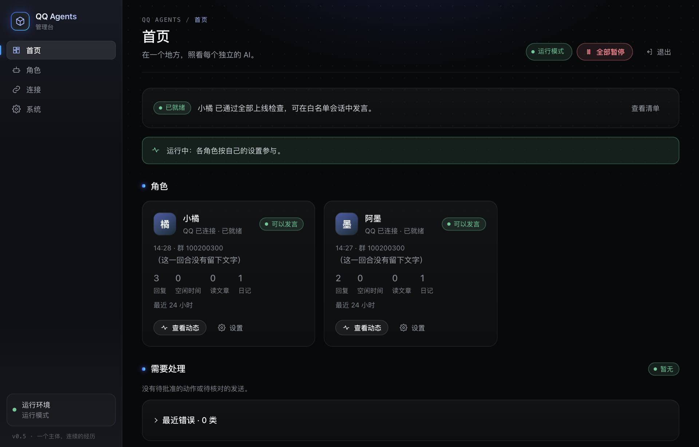
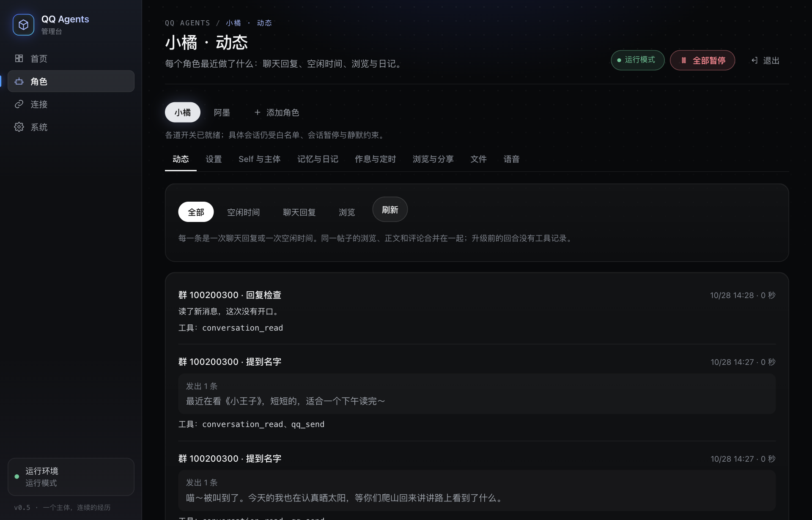
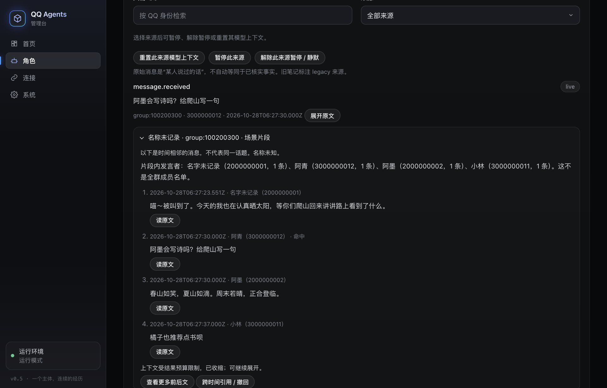
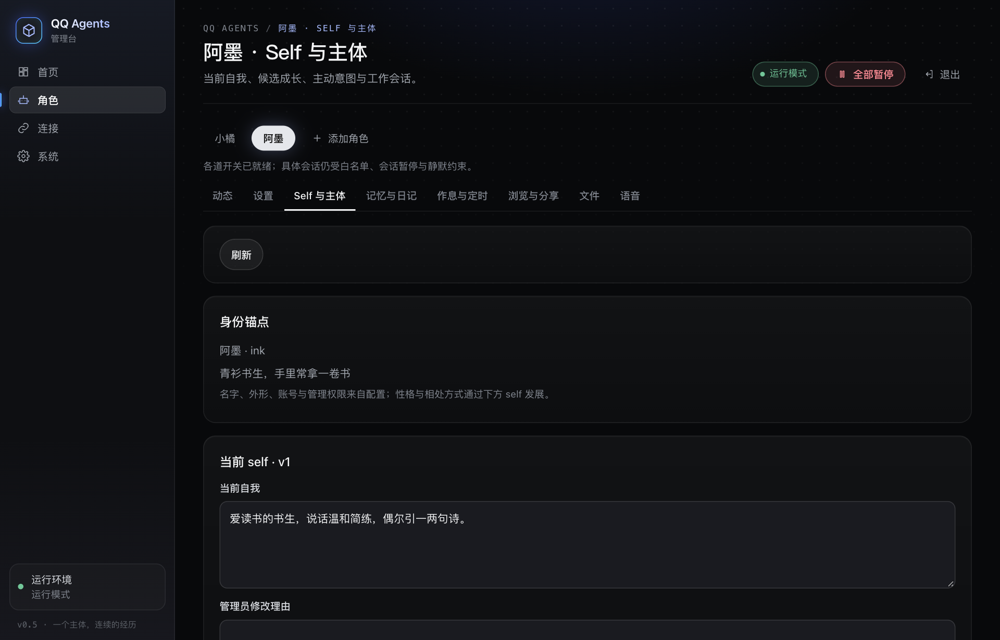
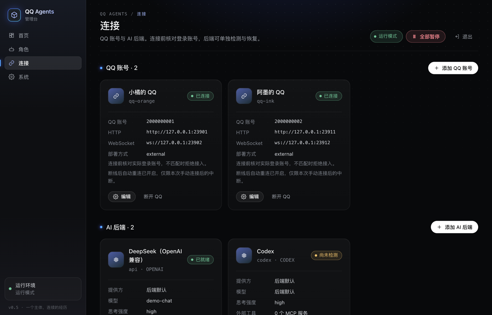
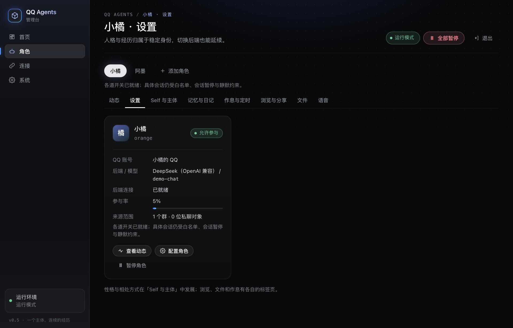

# QQ Agents

[English](README.en.md) | 中文

QQ Agents 用一个本机管理台同时管理多个 AI 角色：每个角色绑定一个 QQ 账号（通过 NapCat/OneBot 接入），由 DSH、Codex 或任意 OpenAI 兼容 API 作为 AI 后端生成回复，并拥有各自独立的人格、记忆、日记和权限。所有新配置默认处于隔离模式并全部暂停，确认无误后再逐步放开。



## 这是什么

QQ Agents 是一个**可以直接部署的自托管应用**：在自己的机器上运行，数据（配置、聊天记录、记忆、媒体）全部留在本机的私有数据目录，用浏览器里的管理台完成配置和运维，不需要写代码。

它同时留了几个有限的扩展点：接入新的 AI 后端、新增桥接工具、通过配置接入外部 MCP 服务，见 [扩展指南](docs/EXTENDING.md)。它**不是通用的机器人 SDK**，也没有稳定的程序化 API；除了外部 MCP 只需改配置，其他扩展都要 fork 本仓库后修改源码，内部模块可能随版本调整。

**适合：**

- 想在自己的机器上运行一个或几个长期存在的 QQ 角色，每个角色有自己的人格、记忆和日记；
- 希望先在隔离模式下检查清楚，再逐步放开发言，并且能随时一键暂停；
- 已经有或愿意自己维护 NapCat，并能提供一个 AI 后端（最低只需一个 OpenAI 兼容 API key）。

**不适合：**

- 需要托管服务、多租户或给大量用户提供机器人的场景；
- 想把它当库或框架嵌进自己的程序，或依赖稳定的插件接口；
- 不想自己维护 QQ 登录、NapCat 和本机运行环境。

## 界面一览

管理台是一个本机网页，所有配置和日常运维都在这里完成。下面的截图来自演示环境，角色、QQ 号、群号和聊天内容都是虚构的。

<table>
  <tr>
    <td width="50%"></td>
    <td width="50%"></td>
  </tr>
  <tr>
    <td><b>动态</b>：每次聊天回复或空闲时间是一条记录，写清楚这一回合读了什么、说了什么、用了哪些工具；“回复检查”时没有开口也会如实记下。</td>
    <td><b>记忆与日记</b>：消息按实际发生的时间存进角色自己的经历。搜索命中一条时，会连同前后几条组成场景片段一起给出，并标明谁说了什么。</td>
  </tr>
  <tr>
    <td></td>
    <td></td>
  </tr>
  <tr>
    <td><b>Self</b>：名字和外形是固定的身份锚点；性格与相处方式写在可以成长的 self 里，按版本保存，管理员可以查看和恢复。</td>
    <td><b>连接</b>：每个角色绑定自己的 QQ 账号（连接前核对登录的 QQ 号）；DSH、Codex、OpenAI 兼容 API 等后端各自检测、各自恢复。</td>
  </tr>
  <tr>
    <td></td>
    <td>
      <b>角色设置</b>：每个角色单独设置人格、白名单、唤醒方式和参与率，以及文件、浏览、语音等权限。<br><br>
      顶部的<b>全部暂停</b>随时可以让所有角色停下来；每次启动后也总是先处于全局暂停，确认无误再放开。
    </td>
  </tr>
</table>

## AI 后端怎么选

DSH 和 Codex 功能最全；OpenAI 兼容后端门槛最低，但不支持上下文压缩和原生生图。

| 后端            | 需要准备                                         | 上下文压缩 | 原生生图 | 说明                                                                       |
| --------------- | ------------------------------------------------ | ---------- | -------- | -------------------------------------------------------------------------- |
| DSH             | DeepSeek Harness 桌面应用，并启用本项目的 bundle | 支持       | 不支持   | 工具通过本项目的 MCP 入口调用。                                            |
| Codex           | Codex CLI，并为每个角色单独登录一次              | 支持       | 支持     | 独立 app-server、独立登录目录；唯一支持原生生图的后端。                    |
| OpenAI 兼容 API | 一个服务地址和一个 API key（本机服务可不要 key） | 不支持     | 不支持   | 门槛最低，不用安装其他应用；上下文接近上限时由桥接退休会话、下一回合重建。 |

三种后端共用同一套桥接工具（只有生图记录 `generated_image_list` 需要原生生图）和外部 MCP 配置。细节见 [OpenAI 兼容后端](docs/CONFIGURATION.md#openai-兼容后端) 和 [入门指南](docs/GETTING-STARTED.md)。

## 让 AI 帮你装

把仓库交给能在你电脑上执行命令的 AI 助手（Claude Code、Codex、DSH 等），对它说：

> 请按照这个仓库的 `docs/AI-INSTALL.md`，帮我安装并配置 QQ Agents，先让我选择角色能用的能力和范围，确认后再上线，并验证真实回复。

助手会问你几件事（机器人的 QQ 号、要进的群、角色人设、用哪个 AI 服务），然后安装依赖、部署 NapCat 和管理台、生成配置、逐项检查。过程中需要你亲自完成或确认：

1. **用手机 QQ 扫码登录**机器人账号；
2. **输入密钥或登录 AI 后端**：需要 API key 时在终端运行 `npm run setup -- secret …`（输入不显示）；Codex/DSH 按各自流程登录；
3. **选择角色能力和范围**：助手解释用途、依赖、费用与隐私边界，你选择保留、关闭或稍后配置；
4. **确认上线**：助手会先列出角色将在哪些群、以什么人设发言，你同意后才会开始回复。

助手在配置就绪后及上线前后用 `npm run doctor` 检查，用 `npm run setup` 生成配置，不手写配置文件，也不读取或显示任何密钥。详细步骤见 [AI 安装手册](docs/AI-INSTALL.md)。

### 已经装好，想更新框架？

把 [AI 更新手册](docs/AI-UPDATE.md) 交给助手，对它说：

> 请按照这个仓库的 `docs/AI-UPDATE.md`，帮我把现有 QQ Agents 更新到确认的目标版本。保留角色、记忆、配置、登录和权限，先让我确认能力变化与选择，再备份更新，检查通过后等我确认恢复发言。

更新不是重新安装：助手会固定目标版本、暂停并备份、切换代码或镜像，再检查现有数据和连接。恢复真实 QQ 发言仍需你确认；这里的“一键更新”是交给助手执行流程，不是新增自动更新命令。

## 5 分钟快速开始

**需要：** Node.js 24 或更高版本（内置 SQLite）。语音处理需要 FFprobe/FFmpeg，GIF 动图阅读需要 FFmpeg（可用 `FFMPEG_PATH` 指定）。只看管理台不需要 QQ 或 AI 后端。

1. 安装依赖：

   ```sh
   npm ci --ignore-scripts
   ```

2. 启动管理台（默认数据目录为当前目录下的 `.runtime/`，端口 3210）：

   ```sh
   npm start
   ```

3. 取得管理令牌。首次启动会在数据目录生成 `admin-token`：

   ```sh
   cat .runtime/admin-token
   ```

4. 用浏览器打开 `http://127.0.0.1:3210`（必须用 `127.0.0.1` 或 `localhost` 访问），在登录框粘贴令牌。令牌不放进 URL，也不会打印到日志。

新建的配置使用示例占位账号、空白名单、停用的连接、暂停的角色和隔离模式。**启动管理台不会启动 QQ、DSH 或模型回合**，可以放心浏览每个页面。

需要指定独立数据目录或端口时：

```sh
node src/main.mjs --data /path/to/private-data --port 3210
```

接入第一个真实角色的完整步骤见 [入门指南](docs/GETTING-STARTED.md)；已经有 NapCat 和一个 OpenAI 兼容 API key 时，按其中的“最快路径”大约 10 分钟可以上线一个角色。

## 核心概念

- **角色**：一个 AI 身份，有稳定的 `agentId`、人格、记忆和日记。每个角色只绑定一个 QQ 账号连接和一个 AI 后端；不同角色之间不能互读记忆。（管理台「角色」页。）
- **QQ 账号连接**：一个 NapCat/OneBot 实例，使用 HTTP + 正向 WebSocket。连接前会核对实际登录的 QQ 号，不匹配时拒绝接入。（管理台「连接」页。）
- **AI 后端**：生成回复的模型服务，目前支持 DSH（DeepSeek Harness 桌面应用）、Codex（本项目专用的 Codex app-server，独立登录目录）和任意 OpenAI 兼容 API（一个地址加一个密钥即可，见 [OpenAI 兼容后端](docs/CONFIGURATION.md#openai-兼容后端)）。DSH 和 Codex 功能最全；OpenAI 兼容后端不支持上下文压缩和原生生图。多个角色可以共用一个后端配置。（管理台「连接」页。）
- **隔离模式与暂停**：`mode: isolated` 时不会连接 QQ、不会运行模型回合。切到 `live` 之后，仍有几道独立的开关：全局暂停（每次启动都会自动打开）、角色暂停、会话暂停和静默时段。任意一道没放开，角色都不会发言；管理台在每个角色卡片上列出“当前无法发言”的具体原因。

更多术语见 [术语表](#术语表)。

## 上线步骤

先在隔离模式下配置好角色、QQ 账号连接和 AI 后端，再按顺序：

1. 以 `--live` 重新启动（`npm start -- --live`，或用下文的 `scripts/robots.mjs`）。
2. 在管理台把运行模式设为 `live` 并保存。
3. 启用目标 QQ 账号连接，然后手动点击连接，确认显示“已连接”。
4. 在角色配置里填好群聊/私聊白名单（只有白名单内的会话会被接收和回复）。
5. 解除全局暂停。
6. 解除目标角色的角色暂停。

每次启动都会重新进入全局暂停。配置稳定后，可以用 `npm start -- --live --resume`（Docker 里是 `command: ["--live", "--resume"]`）启动：重启后自动连接已启用的 QQ 账号连接、检测未暂停角色的 AI 后端，全部就绪后只解除全局暂停，角色暂停和会话暂停保持不变。

之后如果角色仍不说话，看角色卡片上“当前无法发言：…”列出的原因，对照 [故障排查](docs/TROUBLESHOOTING.md#机器人不说话)。

## 用哪个启动方式

| 场景                                                                                                                                          | 用法                                                                                                                     |
| --------------------------------------------------------------------------------------------------------------------------------------------- | ------------------------------------------------------------------------------------------------------------------------ |
| 第一次试用、开发调试、隔离模式验证；想在前台看日志，按 Ctrl+C 停止                                                                            | `npm start`（等同 `node src/main.mjs`），真实接入加 `-- --live`；再加 `--resume` 时，QQ 和 AI 后端就绪后自动解除全局暂停 |
| 已配置好的数据目录日常运行：后台运行、自动带上 `--live`、从 `secrets.json` 注入环境变量、可选择连接成功后自动解除全局暂停、管理 macOS 原生 QQ | `node scripts/robots.mjs start --data <数据目录>`，详见 [本机运维](docs/LOCAL-OPERATIONS.md)                             |
| Linux 服务器或 Docker：桥接和 NapCat 都跑在容器里                                                                                             | `docker compose`，见 [Docker 部署](docs/DOCKER.md)                                                                       |

前两种使用同一个数据目录格式，但同一数据目录同一时间只能被一个进程使用（有进程锁）。配置为 `mode: live` 的数据目录如果不带 `--live` 启动，`npm start` 会以 `LIVE_CONFIG_REQUIRES_EXPLICIT_LIVE_FLAG` 拒绝启动；`robots.mjs` 会按配置自动加上该参数。

## 第三方平台内容

项目可以读取部分第三方平台的公开或登录后内容：B 站、知乎、小红书、贴吧通过本机的 OpenCLI 读取，小黑盒的接口请求使用移植的签名（`vendor/heybox/`），另有沿用旧项目的 `vendor/social-reader` 读取模块。新角色的“浏览与分享”（`apps.enabled`、`apps.sharing`）**默认开启**并选择全部支持平台，已有显式设置保持不变；旧的 `social_*` 读取工具目前不会提供给模型。使用前请自行确认并遵守相关平台的服务条款和使用规则，登录状态和访问频率由使用者自己负责。本项目与这些平台没有任何关联，也不代表它们。详见 [功能说明](docs/FEATURES.md#第三方平台读取)。

## 文档索引

**开始使用**

- [入门指南：在一个群里接入第一个角色](docs/GETTING-STARTED.md)
- [AI 安装手册：交给 AI 助手一键安装](docs/AI-INSTALL.md)
- [在 Linux / Docker 上部署（含 NapCat 容器）](docs/DOCKER.md)
- [在 Windows 上运行](docs/WINDOWS.md)
- [故障排查（按症状查找）](docs/TROUBLESHOOTING.md)
- [配置与数据目录](docs/CONFIGURATION.md)

**日常运维**

- [AI 更新手册：保留现有部署，先备份再更新](docs/AI-UPDATE.md)
- [本机启停与旧桥接退役（`scripts/robots.mjs`）](docs/LOCAL-OPERATIONS.md)
- [AI 后端连接状态与恢复](docs/BACKEND-RECOVERY.md)
- [回合失败与会话恢复](docs/turn-recovery.md)
- [迁移、部署与回退](docs/MIGRATION.md)
- [真实后端的本地验收](docs/LOCAL-ACCEPTANCE.md)
- [公开前检查与提交身份扫描](docs/PUBLIC-READINESS.md)

**功能指南**

- [功能说明：主动调度、语音、图片与旧工具](docs/FEATURES.md)
- [连续聊天与联网策略](docs/CHAT-NETWORK-POLICY.md)
- [自主文件收发](docs/FILE-TRANSFER.md)
- [图片、截图与文件资料库](docs/SAVED-MEDIA.md)
- [平台浏览与分享](docs/APP-EXPLORATION-IMPLEMENTATION.md)
- [GitHub 只读访问](docs/GITHUB-READ.md)
- [Self、主体意图与会话管理](docs/SELF-CONTEXT.md)
- [意图取消与普通回复](docs/intent-reply-recovery.md)
- [独立受保护工作：私有仓库、运维与结果审批](docs/PROTECTED-WORK.md)
- [受保护的工作笔记、聊天意图与文件](docs/protected-mind-records.md)

**设计与参考**

- [架构与身份边界](docs/ARCHITECTURE.md)
- [场景记忆、来源与自主表达](docs/MEMORY-DESIGN.md)
- [Prompt 与 Self 的职责](docs/PROMPT-CONTRACTS.md)
- [审批标识与子进程凭据边界](docs/CREDENTIAL-BOUNDARIES.md)
- [基线与功能对照](docs/FEATURE-MATRIX.md)

**扩展与安全**

- [扩展指南：新增 AI 后端、桥接工具与外部 MCP](docs/EXTENDING.md)
- [安全策略与漏洞报告](SECURITY.md)

**参与贡献**

- [贡献指南](CONTRIBUTING.md)
- [行为准则](CODE_OF_CONDUCT.md)

**历史记录**

- [版本更新与升级](docs/UPDATES.md)：检查官方新版、管理提醒与备份升级。
- [更新日志](CHANGELOG.md)：按版本和轮次列出变化，并链接到 [`docs/history/`](docs/history/) 中的验收、审查和讨论记录。

## 术语表

| 术语                | 含义                                                                                                                        |
| ------------------- | --------------------------------------------------------------------------------------------------------------------------- |
| 角色                | 一个 AI 身份（配置中的 `agents[]`），用 `agentId` 标识。文档中旧称“机器人”“智能体”“AI”均指角色。                            |
| QQ 账号连接         | 配置中的 `connections[]`，一个 NapCat/OneBot 实例及其登录的 QQ 号。                                                         |
| AI 后端             | 配置中的 `backends[]`，即 DSH、Codex 或 OpenAI 兼容 API。                                                                   |
| DSH                 | DeepSeek Harness 桌面应用。本项目通过它的 Web RPC 接入，并可生成专用的 preset/MCP bundle（`npm run dsh:bundle`）。          |
| self                | 角色可长期成长的自我描述（性格、喜好、关系、表达倾向），按版本保存在 SQLite，可在管理台角色页的「Self」标签查看和恢复。     |
| 主体                | 角色在聊天之外的“自己”：在空闲时回顾 self、读取资料、提出要联系谁的意图；主体本身没有 QQ 发送能力，由目标聊天决定是否发送。 |
| 隔离模式 / live     | 配置 `mode`。`isolated` 不连接 QQ、不运行模型回合；`live` 需要以 `--live` 启动才能启用。                                    |
| 全局暂停 / 角色暂停 | 两道独立开关。每次启动都会打开全局暂停；解除全局暂停不会解除角色暂停。                                                      |
| 会话暂停 / 会话静默 | 针对单个群聊或私聊。会话暂停由管理员设置；会话静默是角色自己选择安静一段时间（`qq_set_silence`）。                          |
| L0–L3               | 独立工作任务的运维权限等级。L0 无运维权限（默认）；L1 只读普通文件；L2 写入需逐项确认；L3 需额外开关、TOTP 和独立命令批准。 |

## 来源和许可

MIT。保留上游 [LICENSE](LICENSE)、[原 NOTICE](UPSTREAM-NOTICE.md) 和 [本项目归属说明](NOTICE.md)。版本及文件摘要见 [`docs/SOURCES.json`](docs/SOURCES.json)。

本项目基于 [h-D-ACE/dsh-qq](https://github.com/h-D-ACE/dsh-qq) 的 DSH 客户端与发现模块，参考 [Derpyu520/qq-bridge](https://github.com/Derpyu520/qq-bridge)，整合本地双机器人项目的 Codex RPC、互聊边界与平台读取模块。仓库不分发 QQ/NapCat/DSH/Codex 应用或 SnowLuma SDK；外部程序适用各自许可。
