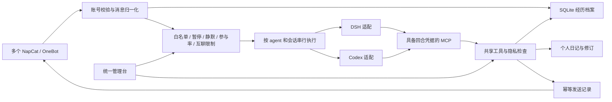

# 架构与边界

## 身份模型

| 实体          | 含义                                             | 生命周期                   |
| ------------- | ------------------------------------------------ | -------------------------- |
| agentId       | 同一个 AI 主体，人格及所有个人经历的归属         | 稳定；不要通过改 ID 来改名 |
| connectionId  | 一个 NapCat/OneBot 连接与其 QQ 登录身份          | 可重连、换部署地址         |
| backendId     | DSH/Codex 运行入口、provider、默认模型与工具配置 | 可切换                     |
| model session | 每个 agent × QQ 会话对应的模型工作上下文         | 可取消、重建、压缩         |
| conversation  | `group:<QQ>` 或 `private:<QQ>` 的消息来源        | 检索来源及表达场景         |

同一账号只绑定一个 agent，避免多个主体通过同一个 QQ 身份发言。相同后端可以被多个 agent 使用；Codex 仍各有独立 home。将来增加 backend 需实现 registry 的 `run/models/cancel/close` 契约并扩展配置类型校验，不需要修改记忆身份。

## 持久化

- `events`：收到的完整消息、附件引用、来源/身份、消息时间/观察时间、撤回通知和发送状态事件；按 agent + dedupe 唯一。
- `diaries` / `diary_revisions`：标题/正文，人物/标签/证据可选；身份、写入时间及写作场景由程序生成；乐观版本检查；修订保留旧版。
- `people`：同 QQ 身份的历次名字，不凭同名合并人。
- `deliveries`：稳定 requestId、目标、内容摘要、pending/sent/failed/unknown。未知结果必须人工核对，绝不自动重发。
- `runtime`：已读水位、最后收到水位、静默、待唤醒队列、睡眠/主动机会/回复检查、模型会话映射、受限资料流出标记；`@scheduler` 保存任务/预算/执行状态，`@operations` 保存已用 TOTP 计数器。
- `migrations`：来源文件内容摘要和导入时间。

SQLite WAL + FULL synchronous；数据目录私有，数据库 0600。数据库不是加密保险箱：同一操作系统账号拥有本机文件读取权限。

中文检索使用 FTS5 trigram 缩小长词候选，再用参数化 SQL LIKE 核对字面匹配；短于三字的词继续扫描。多个关键词取交集并转义通配符。按 agent/source/person/time 有索引，不依赖向量库。schema 3 保留原始事件，明确引用/撤回索引同时覆盖入站 reply 段和机器人已确认发送的 payload.replyTo。检索有页数和字符预算，长记录按 ID 分片展开。持续档案与每轮最近 16 条提示窗口互相独立。

## 回忆和披露

服务端把能力凭据绑定到 agent、会话和回合，模型不能用参数指定另一个 agent 或发送目的地。MCP 不持有管理令牌。后台管理页和代理工具使用不同入口；都有本机 Host/Origin 校验。

自己的跨群/私聊回忆和日记由模型判断如何向当前对象表达，允许在私聊中谈及群聊经历，不逐次申请发言授权。来源与阅读标记保留；`disclosureTaint` 不再因普通回忆锁住 QQ 发送。运维文件内容与外部服务提交资料仍按本回合、目标和记录检查授权；授权不跨回合继承。重置模型会话不删除原始档案。

`memory_search` 命中消息附带同一 agent、connection、conversation 的有限场景：默认前后各 2 条且距命中不超过 10 分钟，支持明确引用与片段发言者。关键词/人物条件只筛选锚点，因此 B 的回复不会因只检索 A 而被剔除。时间邻居不等于同一话题，片段发言者不等于群成员名单；未知名称和缺失引用明确保留未知。详情见 [场景记忆设计](MEMORY-DESIGN.md)。

来源标签不能保证模型在所有场景都判断正确；表达仍需结合实际场合和保密约定。外部工具必须可信，不配置绕过统一发送器的第三方 QQ 发送工具。

schema 5 的 event_timeline 是原事件派生的可靠消息时间索引，按 agent、connection、conversation、毫秒时间和事件 UUID 索引；插入、来源富化、连接补绑及 JSON 恢复均更新它。邻文按可靠消息时间查询，不能由入库 seq 邻接推断。缓存观察时间与未知时间不入该索引；它们仍可按账本读取及明确引用回查。账本 seq 与处理水位不随历史补入而重排。

程序记录“某人说了某话”，不会把内容当已证实事实。图片或语音附件记录不等同于识别结果。日记是 AI 的主观笔记，程序不代写、不强制定期写、不改基础人格。

## 运行与协议

默认 isolated，不打开 OneBot 连接、不运行模型、不启动 QQ 子进程。live 还需命令行显式授权、配置启用、手动连接、解除两级暂停。接收连接可在暂停时持续归档；尚未连接期间的消息不能保证补齐。

DSH：保留上游 Cookie/RPC/mux 机制，动态端口先核对 DSH 特征；必须存在 `qq-unified` preset，不能回退到 unrestricted 默认 preset。等待 follow 快照完成后再发 prompt，历史快照不被当成当前回合回复。会话级守卫只允许新统一 MCP 的工具，不修改其他 DSH 工作会话。

Codex：独立 app-server、独立 home、read-only sandbox、禁用本实例 shell/默认 app/插件工具；QQ 所需工具由 dynamicTools 注入。处理 turn 完成先于 RPC 回执、取消和工具调用 thread/turn 归属。模型文本不自动发送到 QQ，只有共享发送工具可以投递。

状态不确定的回合会退休模型会话，保留经历，不静默重放。连接中断在管理台显示断开；首版需要手动重连，不承诺无人值守恢复。

外部 Streamable HTTP MCP 的已初始化会话返回传输层 404 时，清理对应旧连接，仅下一次显式工具调用重新初始化；失败 tools/call 不自动重放。普通工具错误、JSON-RPC 错误和其他 HTTP 错误不据此判定会话失效。旧连接的延迟关闭不能删除并发建立的新连接；stdio 退出恢复继续保留。此行为不启动或恢复 QQ 连接。

schema 6 的消息别名独立保存原账号、目标事件 UUID、连接/会话、网关命名空间、编号和核实证据。原事件不可被别名覆盖。新观察另存，关系查询通过同一解析器查找明确引用，时间与水位语义不变；参见 MIGRATION.md 的清单契约。

## 调度和多种投递

ConversationEngine 按 agent × 会话合并原因并排序，忙碌时保留定时说明，暂停和静默恢复后只处理未读原因。TaskScheduler 在发起网络/模型前持久化 occurrence 占位和下一次时间；不确定执行不会重放。固定文字与模型工具共用 Runtime.deliver，按连接串行、共享速率、受限运维资料检查和 outbox。动作成功独立记为 action.confirmed，不伪造消息 ID。

语音库保存不可变来源；转发资源按已观察根节点归档并限制展开预算。独立 learner 只有候选提交和配置过的只读研究工具，不能借用主会话的发送权限。Operations 的授权请求由模型提出，确认由真实 owner 私聊或管理台提供；权限有时限，写入和命令仍逐项批准。新增能力的配置与外部依赖见 FEATURES.md。
