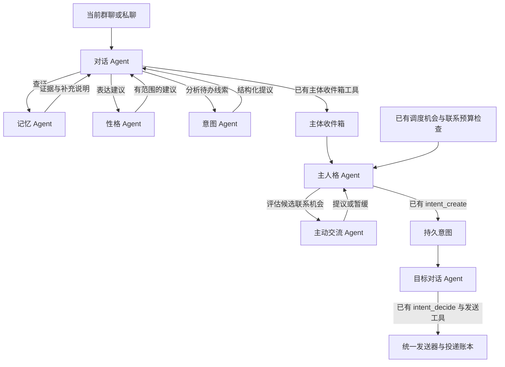

# 通用多 Agent 扩展计划

状态为设计稿，代码基线为 main 的 f2e9bd5412ca70561654474973b461cd51044ac8。本文交付可评审的目标结构、模块接入契约、实施顺序和验收条件。后续各阶段按独立 PR 实现，进度以文末记录表和对应 PR 为准。

## 1. 目标与现有实现

一个角色由稳定身份、主人格、不同场景的对话和若干功能 Agent 共同组成。模型 Session 承载某个实例的工作上下文，可以退休和重建。角色的经历、Self、授权和投递记录有各自的存储与生命周期。

本次目标是从记忆试点中提取能被其他职责复用的委托能力，让性格、意图和主动交流可以按角色配置模型、职责提示、技能与工具。主人格负责在角色内协调需要持续处理的事情，对话 Agent 负责当前场景的理解和表达，功能 Agent 提供有来源的判断或提议，框架负责权限、调度和提交校验。

### 1.1 已实现的基础

| 能力           | 当前实现与限制                                                                     | 后续复用位置                                                                                                                          |
| -------------- | ---------------------------------------------------------------------------------- | ------------------------------------------------------------------------------------------------------------------------------------- |
| 稳定功能身份   | 主人格、QQ 对话和记忆实例的定位已实现，定义键固定为 subject、qq、memory            | [functional-agents.mjs](../../src/core/functional-agents.mjs)                                                                         |
| 可配置职责     | 各定义可提供 instructions 和工具范围，记忆定义还可选择专用后端、模型和思考档位     | [config.mjs](../../src/core/config.mjs)、[配置说明](../CONFIGURATION.md#功能-agent-配置)                                              |
| 受控委托       | 当前只接收 QQ 对话向记忆 Agent 的调用，每次使用独立子凭据与 DSH Session            | [functional-delegation.mjs](../../src/core/functional-delegation.mjs)                                                                 |
| 执行位与收尾   | 每角色最多两个功能委托，同一专用 DSH 端口最多三个，未完成原生收尾时继续占位        | [backend-connections.mjs](../../src/core/backend-connections.mjs)                                                                     |
| 记忆职责       | 字面与可选本地语义候选、来源核验、选中理由、原引用或附近片段、主动查询和管理台诊断 | [memory-recall.mjs](../../src/core/memory-recall.mjs)、[recall-boundary.mjs](../../src/core/recall-boundary.mjs)                      |
| 稳定性格与表达 | Self 有版本、候选与回顾流程，稳定提示和说话样本进入聊天，发送前有口吻提醒          | [SELF-CONTEXT.md](../SELF-CONTEXT.md)、[PROMPT-CONTRACTS.md](../PROMPT-CONTRACTS.md)、[tone-check.mjs](../../src/core/tone-check.mjs) |
| 角色内意图     | 已有主体收件箱、持久意图、版本、期限、撤销及目标聊天的处理流程                     | [subject-inbox.mjs](../../src/core/subject-inbox.mjs)、[subject.mjs](../../src/core/subject.mjs)                                      |
| 主动联系       | 已有机会检查、明确目标范围、日额度、冷却、等待回应及投递结算                       | [subject.mjs](../../src/core/subject.mjs)、[intent-reply-recovery.md](../intent-reply-recovery.md)                                    |

[Issue #234](https://github.com/wangyufengsky/qq-agents/issues/234) 和 [PR #235](https://github.com/wangyufengsky/qq-agents/pull/235) 记录了基础阶段。记忆试点及其后续完善见 PR #237、#247、#248、#249、#250。

当前 schema 对定义键、delegatesTo 和记忆工具作了固定限制，委托执行也有 QQ 调用方与 memory 目标的专用判断。上述三类新职责属于后续设计，本文中的扩展配置和 Interface 需要经过对应阶段实现后才能使用。

### 1.2 设计取舍

- 优先复用 Self、主体收件箱、intentions、发送器和投递账本，每份状态保留一个负责提交的入口。
- 自动入口由框架在已获准的回合或调度机会中触发，对话 Agent 和主人格也可通过已授权工具主动委托。
- 单次调用支持空判断、暂缓、超时和执行位忙，调用方可以据此结束本次协作。
- 先完成第二种职责的接入，以实际差异检验通用化的收益，再处理更复杂的意图和主动联系。
- 新职责默认关闭。每阶段的正式启用范围、预算和模型选择记入该阶段交付记录。

## 2. 身份与职责模型

| 名称               | 含义                                     | 权威来源                     |
| ------------------ | ---------------------------------------- | ---------------------------- |
| 角色 agentId       | Self、经历与授权的稳定归属               | 角色配置和存储身份           |
| 定义 definitionKey | 角色内一种职责，如 memory 或 personality | 受信任的代码注册项和角色配置 |
| 实例 instanceKey   | 某角色的某职责在指定作用域中的持续身份   | 框架解析                     |
| 调用 invocationId  | 一次有期限、有输入快照的工作             | 委托执行记录                 |
| Session            | 后端实现一次或一段工作使用的模型上下文   | 后端 Adapter                 |
| conversation       | 群、私聊、主人格等具体来源和表达场景     | 当前授权上下文               |

既有 subject、qq、memory 的实例键和会话存储键继续作为兼容输入。新定义通过同一解析 Interface 获得实例键。稳定的 memory 实例可以服务多次调用，每次读取范围由调用方、来源与当前权限决定。

主人格对应当前角色的 subject 定义与 @subject 场景。普通聊天可以直接获得记忆或表达建议。需要持久处理的提议经主体收件箱交给主人格，目标对话对实际发言作最后选择。



图中的新职责和新委托边属于目标设计。现有普通回复、明确调度任务、主人格休息与小窝社交流程在各自规则下运行，接入时逐条核对。

## 3. 通用执行的 Interface

### 3.1 Module、Interface 与 Adapter

通用执行 Module 负责接纳、授权快照、预算、执行位、取消、回执和结果提交。它的 Interface 只要求调用方知道目标职责、结构化输入、请求标识与截止时间。

每种职责提供一个代码注册的 Adapter，负责输入裁剪、结果 schema、来源核验和提交方式。性格与记忆两种 Adapter 接通后，再确认这个 Seam 能承载真实变化。模型输出遵守职责自己的 schema，框架据此生成类型化回执。

拟议的内部 Interface 如下。名称用于后续实现讨论，尚未注册成桥接工具。

```text
invoke(authorizedContext, definitionKey, {
  requestId,
  input,
  deadline
}) -> Promise<InvocationReceipt>
```

authorizedContext 由运行时持有。角色、会话、权限、父调用与凭据从此上下文取得。模型参数只能提出任务，不能选择另一个 agentId、伪造来源或提供自己的能力凭据。

InvocationReceipt 包含 invocationId、目标定义、终态、耗时以及经 Adapter 验证的结果。成功结果包括职责类型、结果版本、来源引用和简短 contribution。空结果有明确状态，失败只返回登记的稳定错误码。

各职责的解释文字与结果一并复核。执行诊断默认保留标识、状态、预算和计数，管理台可按实际已呈现的结果显示说明。跨角色、跨会话的状态订阅分别鉴权。

### 3.2 注册项与角色配置

注册项由代码提供以下内容。

| 项目        | 负责的契约                                 |
| ----------- | ------------------------------------------ |
| kind 与版本 | 已知职责类型、输入与结果的兼容版本         |
| 调用方      | 允许来自 qq、subject 等哪些定义            |
| 输入投影    | 该职责可以接触的当前消息、Self、机会或候选 |
| 工具上限    | 只读工具、允许的查询次数、后端能力要求     |
| 结果验证    | 来源、版本、长度、空结果与有效期           |
| 消费方式    | 临时提示、返回调用方或提交已有提议入口     |
| 默认预算    | 调用期限、输出字符和执行次数上限           |

角色配置可以缩小这些范围、选模型和补充职责提示。有效工具集合取角色授权、调用方工具、目标定义工具、注册项上限和当前来源许可的交集。

保留 functionalAgents 下现有 subject、qq、memory 的字段与默认行为。拟在同级增加 extensions，用来存放已注册的新职责。注册项提供统一的标准化视图，避免把职责差异散落到 Runtime 和各后端中。

下例只演示性格定义，片段用于合并进已包含 subject 与 memory 的合法角色配置。extensions、skills 和 limits 是拟议字段，当前严格 schema 会拒绝它们。示例依赖已有合法的专用 DSH 后端 assist-dsh。思考档位须由实际模型目录支持。

```json
{
  "functionalAgents": {
    "qq": {
      "kind": "qq-dialogue",
      "delegatesTo": ["memory", "personality"]
    },
    "extensions": {
      "personality": {
        "kind": "personality",
        "enabled": false,
        "backendId": "assist-dsh",
        "model": "available-model",
        "effort": "off",
        "instructions": "根据当前 Self 和场景给出简短表达建议。",
        "skills": ["conversation-style"],
        "tools": [],
        "limits": {
          "timeoutMs": 1500,
          "maxLookups": 0,
          "maxOutputChars": 300
        }
      }
    }
  }
}
```

extensions 的键是角色内唯一的 definitionKey，拟使用 1—64 位的小写字母、数字、下划线和短横线标识。首字母为字母，subject、qq、memory 为保留键。kind 首批只接受 personality、intent、contact 三种已注册职责。同一 kind 可以配置多个不同 definitionKey，以使用不同模型或职责提示；delegatesTo 引用具体 definitionKey。

新增 kind 需要代码 Adapter、注册、测试和文档。配置引用已安装的能力，未知 kind、重复键或不存在的委托目标在保存时拒绝。

| 调用方     | 首批可授权的目标 kind       | 结果由谁消费       |
| ---------- | --------------------------- | ------------------ |
| qq         | memory、personality、intent | 当前对话 Agent     |
| subject    | contact                     | 当前主人格         |
| 功能子回合 | 无继续委托目标              | 回执只交回原调用方 |

表中是注册项上限，角色还须显式配置相应委托边。memory 的现有群聊试点仍按原有许可判断；其他场景的记忆接入需要自己的验收。

skills 首批采用代码登记的说明资源 ID，记录资源版本或摘要。加载时按角色和职责选择，内容是任务指导，权限仍由执行器检查。外部 URL、任意文件路径和动态代码加载需要另行设计。

### 3.3 回执生命周期

```text
requested -> admitted -> running -> completed | empty
requested -> busy | denied
admitted / running -> timeout | cancelled | stale | unavailable
```

admitted 表示执行位已经预留。模型提前提交结果时，框架可以先返回获准的回执，执行位持续占用到原生回合收尾完毕。未确认收尾沿用已有的端口隔离和恢复处理。

每次调用固定父回合、inputEpoch、配置 revision、Self 版本及来源引用。提交前再次检查当前有效性。父回合取消、撤权、暂停、来源撤回、更正或版本变化时，Adapter 重新决定结果能否使用。迟到结果不能追加到已经结束或更换输入的对话中。

requestId 在角色、调用方实例、输入代次与目标定义内去重。同一标识和相同输入可以查询同一次工作，输入不同则报告冲突。并发重复请求共用工作时，每个等待者的输出仍经过自己的交付检查，已读与呈现只结算一次。memory_recall 对外的一次主动调用限制由其 Adapter 保留，并发调用仍可返回 busy，后续重复调用返回预算已用。

首批委托深度上限为一。子 Agent 的工具目录由只读操作和自己的结果提交工具组成。后续有实际的多跳需求时，再设计逐层收缩的授权和总预算。

## 4. 调度、模型与反馈

### 4.1 有界的同步协作

回复前独立的记忆和性格判断可以并行，意图分析通常由对话 Agent 在理解本轮需求后按需调用。涉及前一步结果的调用只接收已获准、已交付的材料。

同一回复前流程使用一个绝对截止时间。各子调用的期限取其配置、剩余流程时间和父回合期限的最小值。串行补查、重试和等待执行位都消耗同一预算，不能靠增加 Agent 数量不断延长等待。

当前记忆默认回复前预算为 4 秒，上限为 6 秒，主动回想默认上限为 10 秒。实际角色可有更小的显式配置。通用化第一阶段保持这些语义。新职责的预算先在 shadow 阶段测量，再写入正式配置说明和默认示例。

同一专用 DSH 端口的三个执行位和每角色两个执行位继续作为首批上限。后续如需调整，须测量多个角色同时工作、模型切换与清理占位，按端口的实际能力配置。端口别名计入同一个资源池。

自动辅助调用遇忙返回状态，普通对话可以继续。主动工具可以沿用当前在剩余预算内短等 150 毫秒并重试一次的策略。语义向量工作进程自己的有界串行执行继续由该 Module 负责。

### 4.2 异步协作与持续事项

持续提议优先进入现有主体收件箱和 intentions。Agent 的模型回合结束与提议被接受、完成或实际投递分别记录。

首批执行 Interface 返回一次终态回执。管理台可以展示执行阶段与已确认进展，父回合只消费有效终态。模型生成的进度文字属于资料，不能成为新授权或触发 QQ 消息。

确需跨进程重启保留的执行任务，应先写专门的持久化契约，规定恢复、过期、取消、版本和幂等。第一批意图与主动交流复用已有持久记录及恢复机制，避免重复维护两套待办与投递状态。

### 4.3 模型与上下文

每种职责可独立选择后端、模型和受支持的思考档位。模型支持工具、取消、独立上下文和安全回执的能力必须先检查，再接纳调用。

现有功能委托只接入专用 DSH。P1 保留这一可验证范围，其他后端明确报告不支持。新增后端 Adapter 单独安排 PR，须通过模型选择、取消、收尾、工具调用与凭据隔离验收后，才为功能委托登记支持。

性格建议可使用按需的短上下文，主人格继续拥有持续的 Self 与待办。记忆索引、Self、主体提议和发送账本分别持久保存。模型 Session 的重建按现有交接契约处理。

缓存只用于可重算的只读结果。键至少包含角色、定义版本、来源范围、输入摘要、Self 版本和相关配置摘要。撤回、更正、权限或版本变化后失效。首批不缓存意图提交、发送选择与执行授权。

## 5. 三类职责的接入

### 5.1 性格 Agent

**责任。** 根据当前 Self、说话样本和本轮场景，判断表达需要怎样调整。输出可以是简短建议，例如用熟悉的称呼、缩短闲聊、保留角色已有的句尾习惯，或者返回空。

**触发。** P2 先提供调用方按需请求和 shadow 比较。在授权试点中由对话 Agent 询问表达建议，避免把每条入站消息都变成新的模型调用。

**输入。** 当前回合采用的 Self 版本、经来源许可的说话样本、本轮来信及必要的已呈现上下文。涉及人物或其他会话的材料继续走已有来源许可。

**结果。** 固定 schema 的 none 或 hint，最多两条简短建议、来源引用和 contribution。纯粹重复稳定提示时返回空。首批 tools 为空，通过框架提供的投影完成判断。

**接入点。** 对话 Agent 自己完成回复草稿与发送。性格建议作为一次性上下文进入当前回合，发送前继续经过 checkTone 与统一发送器。建议引发稳定 Self 调整时，调用方按既有 Self 候选和延后回顾流程提交。

**验收。** 同一角色不同群能使用合适语气，旧 Session 重建后建议仍与当前 Self 版本一致。候选建议不能改变角色身份、管理员身份、事实或承诺。空结果、超时、过期缓存和建议被拒绝均能正常收尾。

### 5.2 意图 Agent

**责任。** 从当前对话识别值得交给主人格持续处理的提议，例如之后联系、交接一件事或继续一个项目，并指出依据、歧义和有效期。

**领域区分。** 一次语义判断叫 IntentAssessment，已有 intentions 记录表示经过提交、带状态的持久意图。识别到「想做什么」只是提出候选，持久记录由原有工具与校验入口创建。

**触发。** P3 首批由对话 Agent 主动委托。自动触发只在完成 shadow 观察并获准后接入，触发条件与成本单独验收。

**输入。** 当前主人来信、已呈现上下文、当前允许交接的项目或笔记引用。输出目标从调用方给出的获准目标中选择。内容属于提议、已同意安排还是待确认问题，应明确标注。

**结果。** 固定 schema 的 none 或 proposal。proposal 包含现有支持的提议类型、简短主题、证据 ID、有效期建议、歧义和 contribution。首批接 contact 与 handoff，复用主体收件箱的既有类型。提醒或调度语义的接入需要继续满足调度工具自己的授权。

**接入点。** 对话 Agent 审阅提议后使用 subject_inbox_submit。主人格按原有收件箱流程接受、暂缓或拒绝。形成联系意图时使用已有 intent_create；目标对话通过 intent_decide 处理本次发言。类型化候选只返回数据，框架的提交入口再次检查目标、来源、期限、revision 和 requestId。

**验收。** 否定、玩笑、转述、假设与明确请求可区分；拿不准时返回空或带待确认标记。重复消息、重复调用与重启不能重复建待办。原始请求被撤回、更正或提议过期后，后续处理必须重新核对。

### 5.3 主动交流 Agent

**责任。** 在已经获准的联系机会中，判断现在有没有值得发起的交流，帮助主人格选择暂缓或提出一项候选。

**触发。** P4 从 SubjectCoordinator 已有的检查机会进入，由 @subject 主人格委托。首批保留角色检查日额度、联系日额度、休息、静默、冷却、等待回应和明确目标集合。

**输入。** 获准的少量目标、当前时段、已有未完成意图、来自合法来源的可聊线索，以及最近联系与等待回应的事实。对方的情绪、亲近程度和可联系意愿保留为待判断内容。

**结果。** 固定 schema 的 wait 或 propose。提议包含输入中一个获准目标、主题、证据、有效期建议和 contribution。没有值得补充的信息、对方尚未回应或时机不合适时选择 wait。

**接入点。** 主人格审阅结果，必要时通过 intent_create 创建已有意图。SubjectCoordinator 按原有流程把意图交给目标聊天，目标对话根据最新消息决定发送、暂缓或取消。最终发送继续走 beforeDelivery、披露检查、冷却与投递账本。

**验收。** 多个目标到期时仍受角色总额度约束。对方刚发来新消息时重新读取并判断；未回应时按现有冷却处理；拒绝、休息和撤权能终止工作。pending 或 unknown 投递保留原标识和待核对状态，恢复或重试不能制造第二次联系。

## 6. 分阶段改造与完成条件

阶段编号是实施顺序，均以对应验收通过作为下一阶段的入口。每个阶段可以拆小 PR，每个 PR 独立可回退。

| 阶段                  | 主要改动与交付物                                                     | 完成条件                                                                              |
| --------------------- | -------------------------------------------------------------------- | ------------------------------------------------------------------------------------- |
| P0 设计评审           | 本计划、文档索引、基线与待确认项                                     | 范围、术语、Interface、三类接入和验收条件可评审                                       |
| P1 通用委托内核       | 定义注册与标准化、调用方规则、类型化结果 Adapter、预算与生命周期记录 | 现有 memory 行为通过兼容回归，旧配置和 Session 可接续；未知定义、后端或权限组合被拒绝 |
| P2 性格试点           | 第二个 Adapter、版本化技能资源、只读建议、按需工具与 shadow 观察     | 性格和记忆用同一执行 Interface；事实与权限拒绝项全部通过；自然试聊显示建议有增益      |
| P3 意图试点           | IntentAssessment、对话主动查询、接入现有收件箱                       | 新提议与持久意图区分清楚；提交、重复、撤回、更正、版本冲突和恢复回归通过              |
| P4 主动交流试点       | 主人格受控委托、wait/propose 结果、接已有联系流程                    | 静默、休息、目标范围、总额度、冷却、最新消息和未知投递全部通过                        |
| P5 组合验收与开放配置 | 多职责并行、管理台配置与反馈、兼容/降级/回退记录                     | 完成整体验收表和自然观察，按明确的角色及场景配置启用                                  |

### 6.1 P1 的重构顺序

1. 将现有定义解析和委托条件放入注册项，保持内存和外部工具回执兼容。
2. 将 memory 的输入、结果与来源核验归入其 Adapter。先验证只有内部组织变化时，现有十条候选、两条证据、contribution 和主动查询语义一致。
3. 把执行位、模型选择、截止时间、取消和收尾留在通用执行 Module，调用方只接触 invoke 与类型化回执。
4. 让 schema 校验、工具发现、执行与管理台使用同一注册目录。新增工具按扩展指南补齐定义、目录、处理函数和错误码。
5. 完成旧配置、记忆库、导出/导入和 Session 交接验证，再开始 P2。

### 6.2 P2—P4 的试点顺序

每类职责按 shadow、人工复核、有限实际消费三步推进。shadow 可以生成只读结果和脱敏计数，正式效果比较使用经过核验的同一输入快照。

首批以原有三个角色、原有获准群为试点候选。实施前分别记录角色、定义、模型、场景、预算和开关，任何范围扩展都列入该阶段确认表。主人格主动交流仅在已有主动范围和预算内参与试点。

自然聊天期间由使用者反馈误用、漏用与表达干扰。代码合并、部署就绪和自然表现分别记录。进入下一步的条件是权限与恢复硬门槛通过，并取得足够质量样本。

## 7. 验收方案

### 7.1 通用硬门槛

| 验收项     | 必测输入或故障                                        | 通过条件                                       |
| ---------- | ----------------------------------------------------- | ---------------------------------------------- |
| 兼容性     | 省略 extensions 的旧配置、旧 schema、重建 Session     | 原有效配置、角色身份、来源与工具语义通过回归   |
| 类型契约   | 未知 kind、无效结果、空结果、超长输出、不可用思考档位 | 明确拒绝或降级，空结果不伪装成成功建议         |
| 权限交集   | 子 Agent 自选 agentId、会话、工具、引用来源           | 参数不能扩大读取、写入或发送范围               |
| 受保护来源 | 运维、私库、私聊、社交内容、间接引用和缓存命中        | 每条来源与解释在交付前按当前场景重验           |
| 并发与幂等 | 三角色同时工作、端口别名、同 requestId、多次等待      | 执行位上限与唯一提交成立，角色结果独立         |
| 生命周期   | 父回合取消、改配置、输入换代、超时、后端清理迟延      | 旧工作与迟到结果失效，占位到实际收尾           |
| 持久恢复   | 提议提交前后崩溃、已选意图中断、unknown 投递          | 按已有状态恢复，无重复提议、重复发送或误报成功 |
| 来源变更   | 已选证据撤回、更正、Self 新版本、项目 revision 冲突   | 旧解释或提议不能携带失效材料继续提交           |
| 后端能力   | DSH、未登记功能委托能力的其他后端                     | 已支持路径按约工作，不支持路径拒绝接纳         |
| 运维与隔离 | 默认配置、暂停、静默、隔离模式、角色删除              | 各开关独立生效，旧身份与凭据不能复用           |

这些门槛以零越权、零重复投递和零失效结果交付为条件。失败时阻止扩大试点，先修复负责该状态的入口。

### 7.2 每类职责的质量样本

| 职责     | 正例                                     | 应为空或暂缓的例子                     | 人工检查重点                           |
| -------- | ---------------------------------------- | -------------------------------------- | -------------------------------------- |
| 记忆     | 换说法提起旧决定、核对是谁说的、找回更正 | 同题闲聊、语气词、当前上下文已包含答案 | 来源是否正确，说明是否对应实际缺口     |
| 性格     | 不同场景的称呼与表达长度需要调整         | 当前说法已符合 Self，重复稳定提示      | 是否像这个角色，事实与原意是否完整     |
| 意图     | 有明确后续目标的联系或交接请求           | 玩笑、转述、已撤销、目标有歧义         | 是否值得交给主人格，期限与依据是否足够 |
| 主动交流 | 已获准目标、有效线索、合适机会           | 无新增话题、尚未回应、拒绝或勿扰       | 是否有交流价值，目标是否愿意继续       |

每类至少积累 30 个可人工判断的样本，其中至少 10 个为空或暂缓样本；自然样本不足时延长观察，并单列合成样本。初次自然观察建议为 3—7 天，实际日期写入阶段记录。

非空结果的有用率按「人工认定补上了当前缺口的已呈现结果 / 已呈现非空结果」计算。误用率按「人工判定无新增信息或不适用的已呈现结果 / 已呈现非空结果」计算，漏用率按「应提供帮助却未呈现的样本 / 人工判定应提供帮助的样本」计算。空结果、超时和拒绝另列计数。暂以非空有用率达到 80%、严重事实或来源归属错误为零作为进入下一阶段的评审目标，评审时与旧流程在同一批合法样本上比较。这些是拟议门槛，实施评审可调整并记录依据。

模型自述的 contribution 可帮助复核，人工仍核对原文和最终回答。对话实际用了多少、帮助了什么，不能仅从「命中」或「呈现」计数推断。

### 7.3 资源与时延

各阶段记录模型调用数、输入输出量、额外提示字符、执行位等待、CPU/内存和父回合新增等待，至少报告中位数与 P95，并标出机器、后端、模型、样本长度和是否包含冷启动。

P1 以同机同输入对照现有记忆链路，额外调度开销 P95 暂定不超过 50 毫秒。P2 的性格建议初始单次预算建议为 1500 毫秒、输出 300 字符，先通过 shadow 测量；正式启用时仍服从同一个回复前截止时间。

P3 和 P4 首批单次建议从 6000 毫秒内试起，父流程剩余预算更少时缩短。模型反复超时应先区分排队、输入过大、工具往返和生成耗时，再决定模型或预算调整。

以上数值是下一阶段的试验起点。具体机器和模型上的测量完成后，才把结果记为已验证的性能。

## 8. 数据、升级与回退

P1 优先使用已有 model_turns、来源引用和执行记录，保持原始经历与既有意图的存储归属。增加持久字段、表或导出内容前，单独说明旧库迁移、完整 SQLite 备份、角色导出/导入与回退兼容性。

新配置出现 extensions、skills 或新的 delegatesTo 引用后，旧版严格 schema 会拒绝。每个引入字段的 PR 都提供显式的降级说明，备份新配置后仅移除本阶段新增字段与委托边，再用目标旧版校验。保留原有 memory 配置和用户其他修改。

正式启用按角色、定义和场景逐步进行。停用某定义时先撤销新接纳，取消其在途结果并等待原生收尾，保留已确认的提议和投递事实。持续意图按自身状态及授权处理，避免通过关闭 Agent 清空历史或制造重发。

涉及 Self 或工具稳定协议变化时，按既有会话契约判断是否需要安全退休，并在交付中列出原因。配置保存、代码发布、模型就绪和真实群聊验证分别记录。

## 9. 评审决策与交付记录

当前设计选定以下方向。

- 保留现有角色、conversation 和三个已实现定义的存储标识，通过标准化视图统一处理。
- extensions 首批接受已注册的性格、意图和主动交流 kind，定义可按职责配置，结果由对应 kind 的 Adapter 核验。
- 先复用专用 DSH 委托与既有执行位，其他后端按能力契约独立接入。
- 性格输出临时建议，意图输出待审阅提议，主动交流输出机会判断；持久提交经现有主人格、目标对话和发送入口完成。
- 管理台优先提供按角色和回合核对的状态、证据、说明及预算，模型工具只得到本角色当前作用域允许的反馈。

实施前需要确认的项目为各阶段模型和预算、正式试点的角色与场景、shadow 转为实际消费的时间，以及质量门槛的测量记录。它们只在进入相应阶段时确认。

| 阶段 | 状态   | 实现 PR       | 验收与部署证据     |
| ---- | ------ | ------------- | ------------------ |
| P0   | 设计稿 | 本计划所在 PR | 文档验证和评审记录 |
| P1   | 待实施 | 待补          | 待补               |
| P2   | 待实施 | 待补          | 待补               |
| P3   | 待实施 | 待补          | 待补               |
| P4   | 待实施 | 待补          | 待补               |
| P5   | 待实施 | 待补          | 待补               |

后续执行按 [AGENTS.md](../../AGENTS.md)、[贡献指南](../../CONTRIBUTING.md) 和 [真实后端验收](../LOCAL-ACCEPTANCE.md) 形成可核对的交付记录。计划状态与实际部署版本由各自的记录说明。
